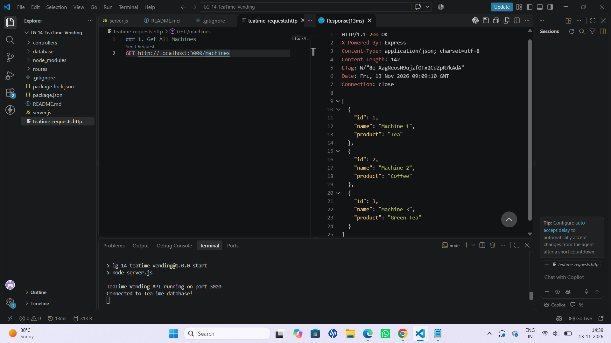
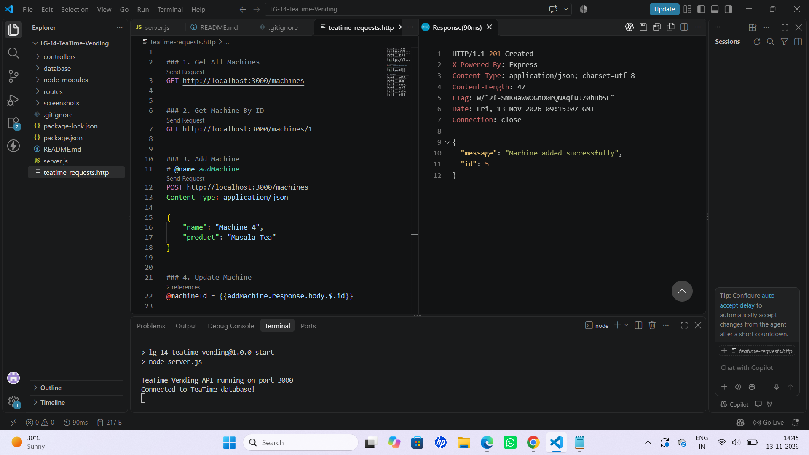
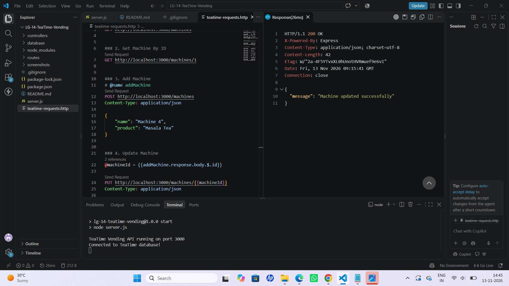
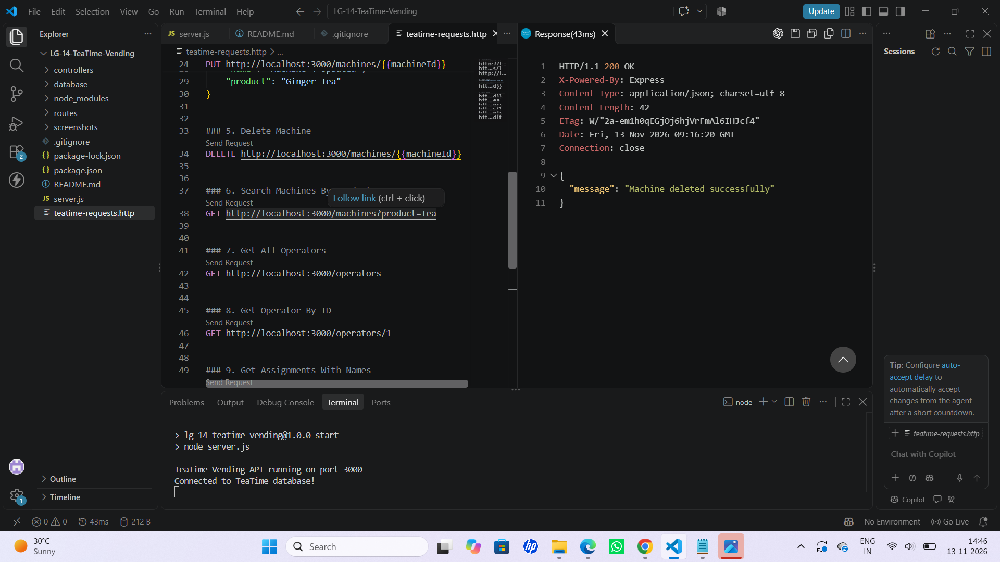
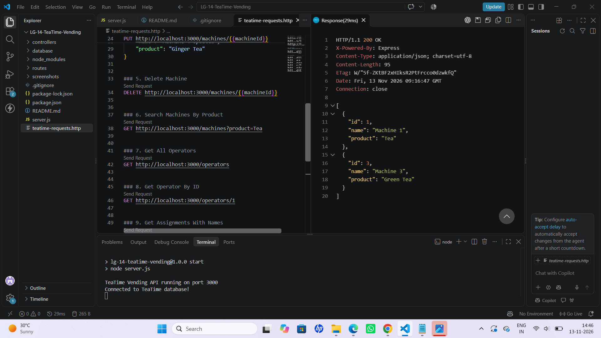
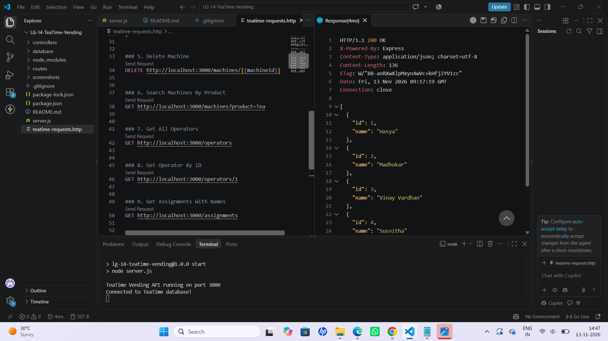
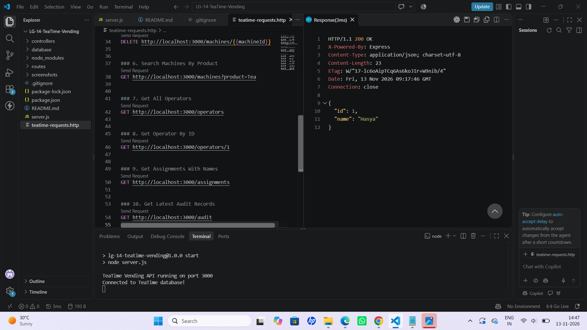
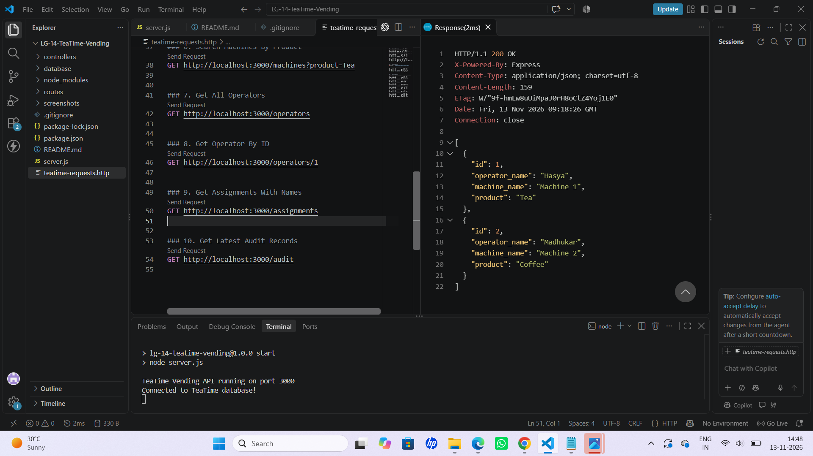
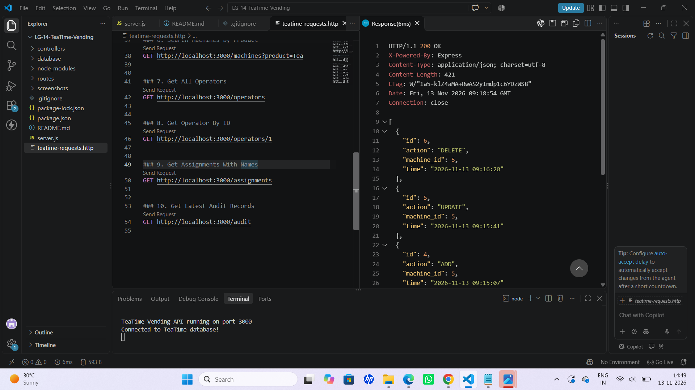

# TeaTime Vending API

## Project Description

TeaTime Vending is a backend application developed using Node.js, Express.js and SQLite. It manages vending machines, operators and their assignments.

The application provides REST API endpoints to perform CRUD operations on machines, retrieve operator information, view machine assignments, search machines by product and maintain an audit trail of machine activities.

## Live API

**Render Deployment:** Create the service using the Blueprint instructions below, then add its URL here.

**GitHub Repository:** https://github.com/gantachandu06-max/Group-Assignment

## Technologies Used

- Node.js
- Express.js
- SQLite3
- JavaScript
- VS Code
- REST Client Extension

## Project Structure

```text
Group-Assignment/
├── render.yaml
└── TeaTime Vending/
    ├── controllers/
    ├── database/
    │   └── db.js
    ├── routes/
    │   ├── assignmentRoutes.js
    │   ├── auditRoutes.js
    │   ├── machineRoutes.js
    │   └── operatorRoutes.js
    ├── screenshots/
    ├── .gitignore
    ├── package.json
    ├── package-lock.json
    ├── README.md
    ├── server.js
    └── teatime-requests.http
```

## Deploy to Render

The repository includes a Render Blueprint at [`render.yaml`](../render.yaml). To create the web service:

1. Sign in to [Render](https://dashboard.render.com) and choose **New → Blueprint**.
2. Connect GitHub and select `gantachandu06-max/Group-Assignment`.
3. Review the `teatime-vending-api` service and choose **Apply** to build and deploy it.
4. When the deployment succeeds, copy the service URL into the **Render Deployment** field above.

The Blueprint uses the `TeaTime Vending` folder as its service root and deploys on Render's free plan. SQLite data is stored on the service's local filesystem, which is ephemeral on the free plan; database changes can be lost when the service restarts or redeploys. The app creates and seeds its database at startup.

## Installation and Setup

### 1. Clone the Repository

```bash
git clone https://github.com/gantachandu06-max/Group-Assignment.git
```

### 2. Navigate to the Project Folder

```bash
cd "Group-Assignment/TeaTime Vending"
```

### 3. Install Dependencies

```bash
npm install
```

### 4. Start the Server

```bash
npm start
```

The server runs on port 3000 by default.

**Expected Output:**

```text
TeaTime Vending API running on port 3000
Connected to TeaTime database!
```

## API Endpoints

### Machines

| Method | Endpoint | Description |
|---|---|---|
| GET | `/machines` | Retrieve all machines |
| GET | `/machines/:id` | Retrieve a machine by ID |
| POST | `/machines` | Add a new machine |
| PUT | `/machines/:id` | Update machine details |
| DELETE | `/machines/:id` | Delete a machine |
| GET | `/machines?product=Tea` | Search machines by product |

### Operators

| Method | Endpoint | Description |
|---|---|---|
| GET | `/operators` | Retrieve all operators |
| GET | `/operators/:id` | Retrieve an operator by ID |

### Assignments

| Method | Endpoint | Description |
|---|---|---|
| GET | `/assignments` | Retrieve assignments with operator and machine names |

### Audit Trail

| Method | Endpoint | Description |
|---|---|---|
| GET | `/audit` | Retrieve the latest 10 audit records |

## Database

The application uses SQLite3 to store and manage data.

The database contains three main tables:

1. **Operators** – Stores operator details.
2. **Machines** – Stores vending machine details.
3. **Assignments** – Stores the relationships between operators and machines.

An additional audit table records machine activities.

## Validation and Error Handling

The application includes validation for machine creation and updates.

- Machine name and product are required.
- Invalid requests return HTTP 400.
- Records that do not exist return HTTP 404.
- Successful requests return appropriate HTTP status codes.

## Audit Trail

The application maintains an audit trail for machine operations.

The following activities are recorded:

- ADD – When a new machine is created.
- UPDATE – When machine details are modified.
- DELETE – When a machine is deleted.

Each audit record stores the action, machine ID and timestamp.

The `/audit` endpoint displays the latest 10 records in descending order.

## API Testing

The API requests are organized in the `teatime-requests.http` file.

The VS Code REST Client extension is used to send HTTP requests and view the API responses directly inside Visual Studio Code.

The requests cover:

1. Get All Machines
2. Get Machine By ID
3. Add Machine
4. Update Machine
5. Delete Machine
6. Search Machines By Product
7. Get All Operators
8. Get Operator By ID
9. Get Assignments With Names
10. Get Latest Audit Records

## Screenshots

Screenshots of the API testing results are stored in the `screenshots/` folder.

### Machine Operations









### Search Machines



### Operator Operations





### Assignments



### Audit Records



## Expected HTTP Status Codes

| Status Code | Description |
|---|---|
| 200 | Request successful |
| 201 | Resource created successfully |
| 400 | Invalid request or missing required fields |
| 404 | Requested resource not found |
| 500 | Internal server error |

## Team Members

**Group 14 – TeaTime Vending**

- B. Hasya
- G. Chandu
- K. Vinay Vardhan
- K. Susvitha
- K. Madhukar

## Conclusion

The TeaTime Vending API demonstrates the implementation of REST API operations using Node.js, Express.js and SQLite. It supports machine management, operator retrieval, assignments, product-based searching, input validation and audit logging.